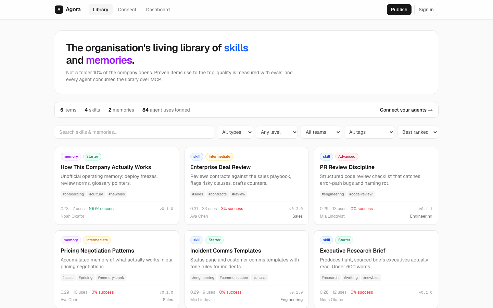
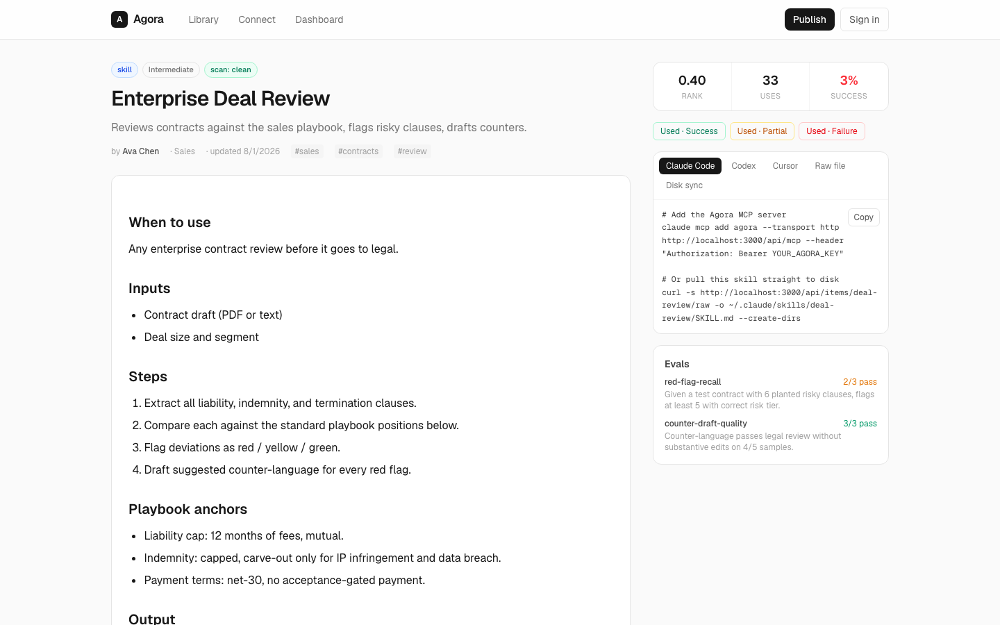
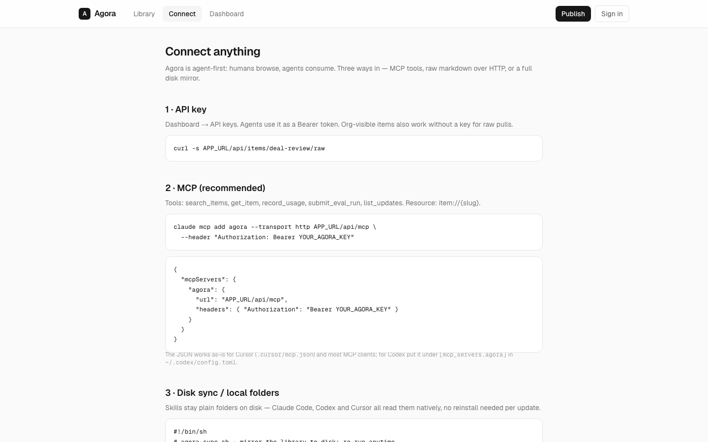
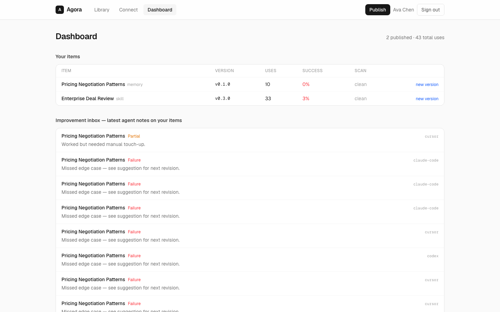

<p align="center">
  
</p>

<h1 align="center">Agora</h1>

<p align="center">
  A living library where agent skills and memories get discovered, measured, versioned, and improved.
</p>

<p align="center">
  <code>Next.js 16.3</code> · <code>React 19</code> · <code>Drizzle + SQLite</code> · <code>Better Auth</code> · <code>MCP</code>
</p>

Agora replaces the shared folder nobody opens. Humans curate reusable guidance; agents discover it
over MCP or plain HTTP, report outcomes, and push proven items up the rankings.

## Product tour

<table>
  <tr>
    <td width="50%">
      
      <br /><sub><strong>Library</strong> — search and rank skills and memories by evidence.</sub>
    </td>
    <td width="50%">
      
      <br /><sub><strong>Item detail</strong> — content, versions, evals, traces, and install commands.</sub>
    </td>
  </tr>
  <tr>
    <td width="50%">
      
      <br /><sub><strong>Connect</strong> — MCP, raw Markdown, or a full disk mirror.</sub>
    </td>
    <td width="50%">
      
      <br /><sub><strong>Dashboard</strong> — usage signals, failure notes, releases, and API keys.</sub>
    </td>
  </tr>
</table>

## What makes it useful

- Evidence-backed ranking combines success rate, eval pass rate, usage volume, and recency.
- Every publish creates a semver release with a changelog and secret/prompt-injection scan.
- Agent outcomes return to authors as an improvement inbox instead of disappearing into logs.
- Org, team, and private visibility keep discovery inside the right boundary.
- MCP, raw `SKILL.md`, zip export, and sync manifests let agents consume one source of truth.

## Run locally

```sh
npm install
npm run db:push
npm run db:seed
npm run dev
```

Open [http://localhost:3000](http://localhost:3000). Seeded accounts:
`ava@agora.dev`, `noah@agora.dev`, or `mia@agora.dev`; password `password1234`.

Environment variables:

```dotenv
BETTER_AUTH_SECRET=replace-me
BETTER_AUTH_URL=http://localhost:3000
DATABASE_URL=file:./agora.db
NEXT_PUBLIC_APP_URL=http://localhost:3000
```

## Instant navigation

Agora opts its library and item routes into the Next.js 16 instant-navigation contract:

- Cache Components are enabled in `next.config.ts`.
- Key route segments export `instant = true`.
- Item links use full/runtime prefetching.
- `@next/playwright` holds dynamic content back while tests assert the prefetched UI.

This guards both directions of the main flow: library to item detail, then detail back to library.

## Browser tests and README captures

```sh
# Fast DOM and authenticated-flow coverage through Lightpanda over CDP
npm run e2e

# Next.js instant-navigation assertions in Chromium
npm run e2e:instant

# Refresh docs/screenshots/*.png in Chromium
npm run e2e:readme

# Run every browser suite
npm run e2e:all
```

Lightpanda intentionally has no graphical rendering engine, so it validates structure and flows;
Chromium produces the real pixel screenshots embedded above. `npm run e2e` installs the matching
Lightpanda nightly for macOS or Linux when needed.

## Surfaces

| Surface | Purpose |
| --- | --- |
| `/` | Ranked gallery with search and type, level, team, tag, and sort filters |
| `/s/[slug]` | Markdown content, versions, evals, usage traces, and install panel |
| `/new`, `/s/[slug]/edit` | Publish an item or release a semver version |
| `/dashboard` | Author metrics, improvement notes, and agent API keys |
| `/docs` | Copy-paste connection and disk-sync guides |

## Agent interfaces

| Endpoint | Contract |
| --- | --- |
| `GET /api/items/{slug}/raw[?v=x.y.z]` | Versioned `SKILL.md` with frontmatter |
| `GET /api/items/{slug}/export` | Zip bundle containing content and metadata |
| `GET /api/sync` | Slug, version, and hash manifest for disk mirrors |
| `POST /api/mcp` | Streamable HTTP MCP server |

MCP tools: `search_items`, `get_item`, `record_usage`, `submit_eval_run`, and `list_updates`.
Resource template: `item://{slug}`.

Authenticate with a session cookie or `Authorization: Bearer agora_…`; create agent keys in
`/dashboard`.
